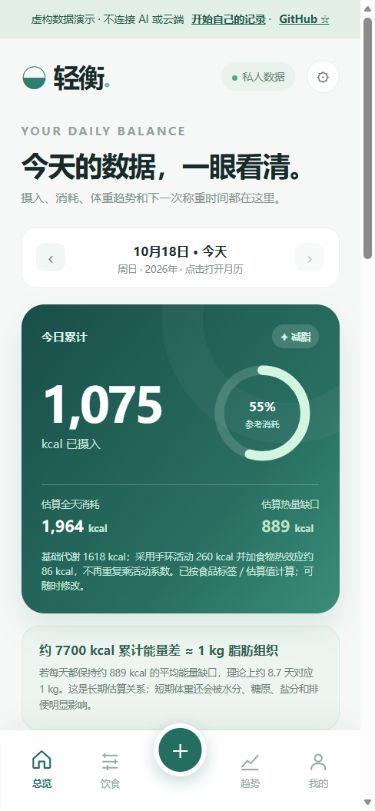
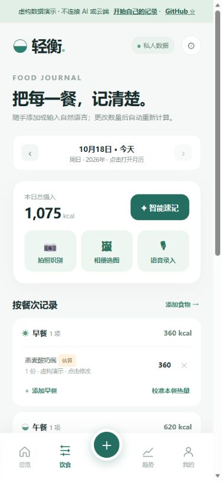
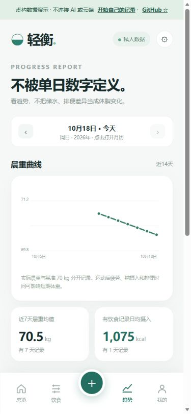

<div align="center">

# 轻衡 · Qingheng

**在手机上记清每一餐，慢慢看见体重趋势。**

本地优先的饮食与体重记录工具。无需注册；AI 和私人云同步按需开启。

[虚构数据演示](https://koapeat.github.io/qingheng-mobile/web/?demo=1) · [开始自己的记录](https://koapeat.github.io/qingheng-mobile/web/) · [自部署](docs/self-hosting.md) · [English](README.en.md)

[](LICENSE)
[](https://github.com/KoaPeat/qingheng-mobile/actions/workflows/ci.yml)
[](https://github.com/KoaPeat/qingheng-mobile/releases)

</div>

<p align="center">
  
  
  
</p>

演示和截图均为虚构示例。演示模式不连接 AI 或云端，不包含作者的私人记录。

## 能做什么

- **记录饮食**：按餐次添加食物，修改份量，查看热量和已知营养素；支持自建食品。
- **观察体重**：晨重、历史趋势、称重提醒及身体资料设置。
- **记录活动与校准**：活动热量、餐次和全天热量校准；缺失营养数据不会当成零。
- **本地保存与备份**：记录保存在当前浏览器，JSON 导入/导出；首次联网加载后可缓存应用外壳。
- **可选 AI 辅助**：自备兼容服务的地址、模型与 API Key，结果先核对再保存。
- **可选私人同步**：使用自己的 Cloudflare Worker/KV 与不同的读写凭据，追加 `day.patch` 事件。

轻衡适合想管理自己记录、愿意自行配置可选服务的个人用户。基础记录不需要账号或云端；AI 服务和云资源可能收费。

## 一分钟试用

直接打开 **[虚构数据演示](https://koapeat.github.io/qingheng-mobile/web/?demo=1)**，查看总览、饮食和趋势。想开始自己的记录，点击演示顶部的“开始自己的记录”，先填写身体资料，再添加第一餐。

初始身体参数仅是通用示例。请改成自己的资料；清除网站数据会删除本机记录，建议定期导出 JSON 备份。

## 在自己的电脑运行

需要 Node.js 20 或以上，不需要安装项目依赖：

```sh
git clone https://github.com/KoaPeat/qingheng-mobile.git
cd qingheng-mobile
npm start
```

打开 `http://127.0.0.1:4173/`；演示地址加上 `?demo=1`。不要直接双击 HTML，浏览器模块需要通过 HTTP(S) 加载。

## 部署与配置

| 想做什么 | 做法 |
| --- | --- |
| 只用本地记录 | 将 `web/` 整个目录部署到任意 HTTPS 静态托管，无需后端 |
| 添加到手机主屏幕 | 在自己的 HTTPS 部署中，使用浏览器的添加到主屏幕功能；实际行为取决于浏览器 |
| 使用 AI | 在“我的 → AI 接口设置”填写自己的兼容服务；服务需允许浏览器跨域请求 |
| 使用私人同步 | 按 [完整自部署说明](docs/self-hosting.md) 创建自己的 Worker 和专用 KV，再填入地址与独立读写凭据 |
| 外部 AI/聊天写入 | 自行配置兼容 REST 连接器；示例 Worker 没有 `/mcp`，不包含 ChatGPT 账号连接或托管代理 |

公开版默认同步地址为空，不连接维护者的私人服务。同步凭据只保存于当前标签页会话，关闭后需重新填写；AI Key 只保留在当前页面内存。它们不进入 JSON 数据备份。

## 当前边界

- 这是**网页开源预览版**，没有附带 APK、iOS 原生应用或完整 Android 工程。
- 浏览器版没有独立的原生语音识别运行时，可使用系统键盘听写或外部 AI 文本导入。
- AI 并非内置免费模型；模型能力、服务费用及浏览器跨域支持取决于你选择的服务。
- 同步模板适合个人试用。KV 有传播延迟，事件按日期/ID 列表顺序合并，尚不保证同时编辑同一条记录的冲突处理；详见部署文档。不要把它当作多用户或强一致数据库。
- 营养、消耗及 AI 估重是记录与估算，不用于诊断或治疗。品牌食品数据以原始来源和实际包装为准。

## 项目结构

```text
web/                    当前开源网页入口与虚构演示
worker/                 可选 REST 同步后端模板（没有生产凭据）
docs/self-hosting.md     部署、配置和排错
docs/launch-kit.md       介绍文案、录屏脚本和推广计划
tests/                  无第三方依赖的 Node 测试
phone/、根目录旧网页      保留既有链接的历史版本，新部署请使用 web/
```

`npm test` 运行测试；`npm run package` 生成不包含 Git 历史、凭据和私人备份的发行目录。

## 一起改进

[报告问题](https://github.com/KoaPeat/qingheng-mobile/issues/new/choose) · [贡献指南](CONTRIBUTING.md) · [安全反馈](SECURITY.md) · [更新记录](CHANGELOG.md)

欢迎提供手机兼容性、自部署文档、无障碍和营养数据来源方面的反馈。公开反馈请去掉个人记录和所有密钥。

如果轻衡对你有帮助，欢迎点一个 **⭐ Star**，也欢迎把它分享给需要的人。

## 许可与来源

项目代码采用 [MIT License](LICENSE)，允许修改和商用，但须保留许可与版权声明。第三方品牌、商标及营养资料的说明见 [NOTICE.md](NOTICE.md)。
